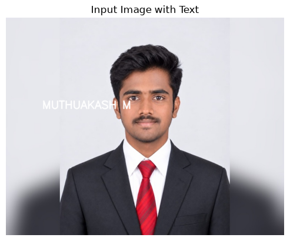
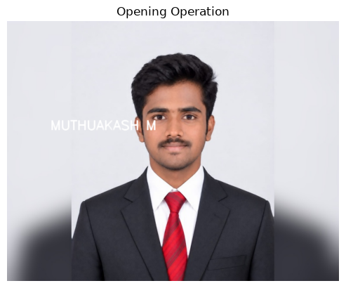

# Experiment 10 – Implementation of Opening and Closing

## Name
MUTHUAKASH M

## Register Number
212225230194

## Aim
To implement morphological opening and closing operations on an image using OpenCV and Python.

## Software Required
- Python
- Jupyter Notebook
- OpenCV (`cv2`)
- NumPy
- Matplotlib

## Input Image Required
- `Qno. 1.jpg`

Place the input image in the same folder as the Jupyter Notebook or Python program.

## Algorithm

1. Import the required libraries: OpenCV, NumPy, and Matplotlib.
2. Read the input image using `cv2.imread()`.
3. Add the text "Open and Close" to the image using `cv2.putText()`.
4. Create a 3 × 3 square kernel using `np.ones()`.
5. Display the input image with text using Matplotlib.
6. Apply the Opening operation using `cv2.morphologyEx()` with `cv2.MORPH_OPEN`.
7. Display the Opening operation output.
8. Apply the Closing operation using `cv2.morphologyEx()` with `cv2.MORPH_CLOSE`.
9. Observe the results of the Opening and Closing operations.

## Program 1: Import Libraries

```python
import cv2
import numpy as np
import matplotlib.pyplot as plt
```

## Program 2: Read the Input Image

```python
# Create a blank image
image = cv2.imread("Qno. 1.jpg")
```

## Program 3: Add Text to the Image

```python
# Add text on the image using cv2.putText
font = cv2.FONT_HERSHEY_SIMPLEX

cv2.putText(image, 'Open and Close', (100, 250), font, 1,
            (255, 255, 255), 2, cv2.LINE_AA)
```

## Program 4: Create the Kernel

```python
# Create a simple square kernel (3x3)
kernel = np.ones((3, 3), np.uint8)
```

## Program 5: Display the Input Image

```python
# Display the input image
plt.imshow(cv2.cvtColor(image, cv2.COLOR_BGR2RGB))
plt.title("Input Image with Text")
plt.axis('off')
```

### Output – Input Image with Text



## Program 6: Apply Opening Operation

```python
# Opening is erosion followed by dilation
opened_image = cv2.morphologyEx(image, cv2.MORPH_OPEN, kernel)
```

## Program 7: Display the Opening Operation

```python
# Display the result of Opening
plt.imshow(cv2.cvtColor(opened_image, cv2.COLOR_BGR2RGB))
plt.title("Opening Operation")
plt.axis('off')
```

### Output – Opening Operation



## Program 8: Apply Closing Operation

```python
# Closing is dilation followed by erosion
closed_image = cv2.morphologyEx(image, cv2.MORPH_CLOSE, kernel)
```

### Output – Closing Operation

The Closing operation is performed using the morphological closing function.

## Result

Thus, the Opening and Closing morphological operations were successfully implemented on an image using OpenCV and Python.